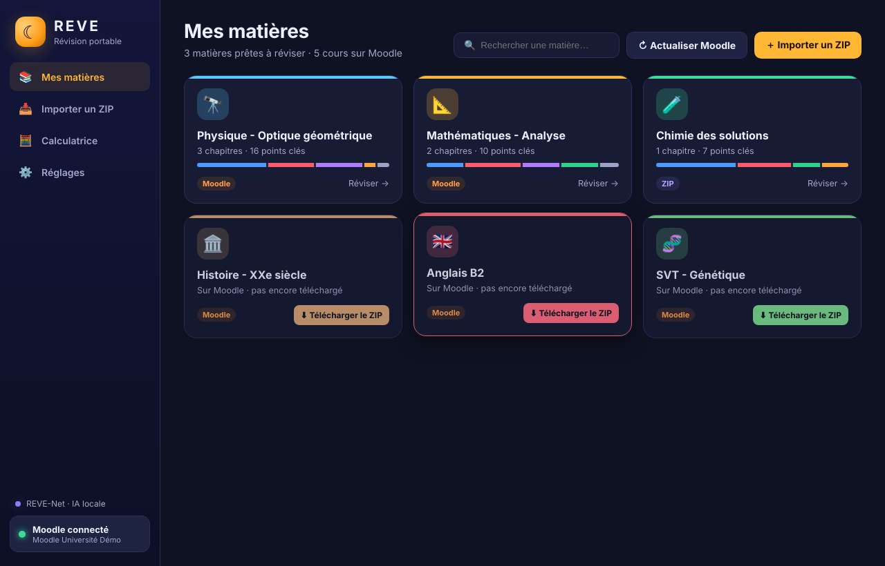
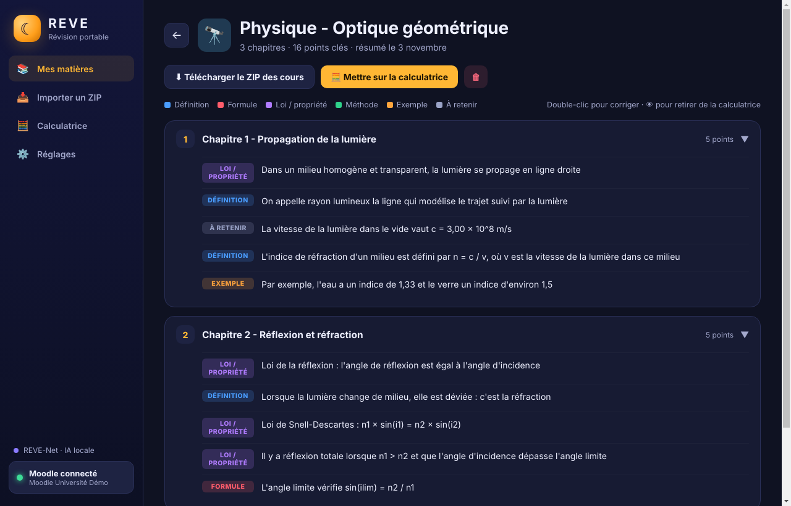
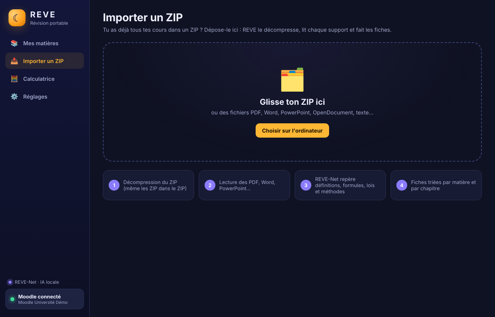
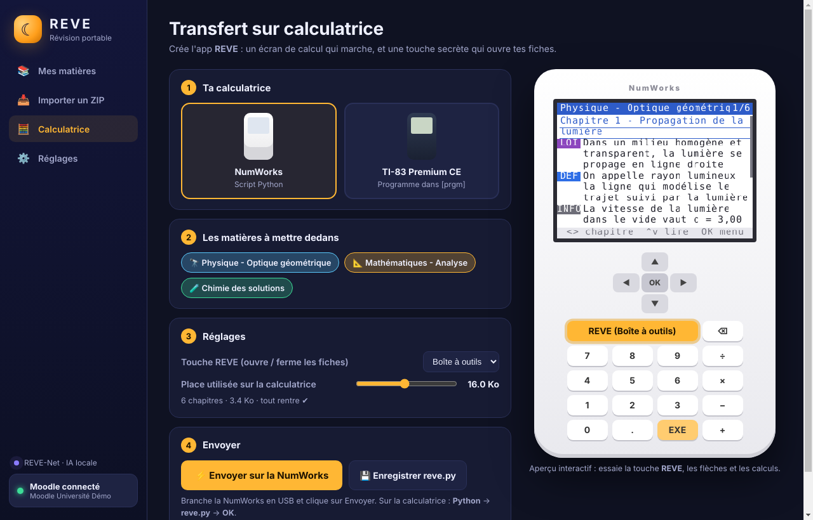
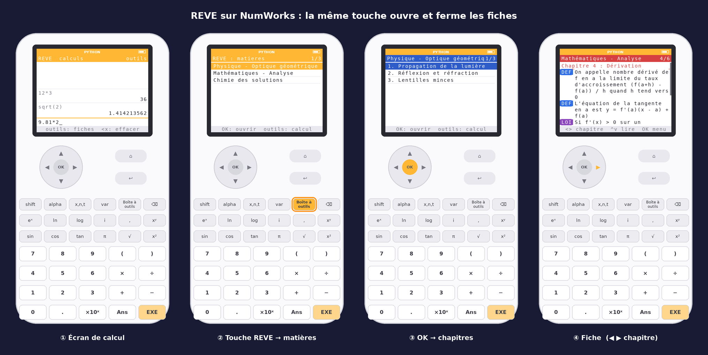
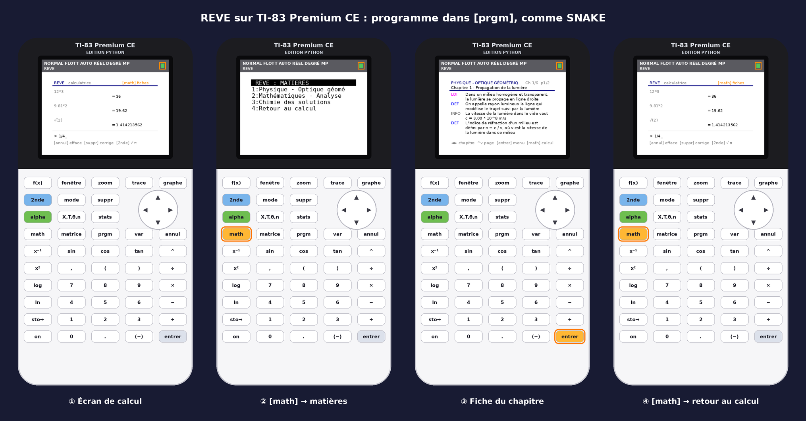

# ☾ REVE — Révision portable

Logiciel **Windows et Mac** qui :

1. **se connecte au Moodle de ton école** (la vraie page de connexion, puis il reste connecté),
2. affiche **toutes tes matières** (Physique, Optique, Maths…) et **télécharge le ZIP** de tous les supports d'un cours en un clic,
3. accepte aussi **un ZIP que tu lui donnes** : il le décompresse et analyse tout,
4. fait des **fiches de révision triées par chapitre** grâce à **REVE-Net**, un petit réseau de neurones intégré (**sans internet, sans Claude**),
5. crée l'app **REVE** sur ta **NumWorks** ou ta **TI-83 Premium CE** : un vrai écran de calcul, et **une touche qui ouvre les fiches** (la même touche les referme).

Tu n'as **jamais besoin d'écrire de code** : tout se fait avec des boutons.

---

## 📸 Captures

| Mes matières | Fiche d'une matière |
|---|---|
|  |  |

| Importer un ZIP | Transfert vers la calculatrice |
|---|---|
|  |  |

### Rendu sur la calculatrice





*Ces images sont produites en faisant tourner le vrai script envoyé sur la calculatrice dans un émulateur d'écran (`tools/calc_emulator.py`).*

---

## ⬇️ Installer

1. Sur GitHub, ouvre l'onglet **Actions** → dernier « Construire REVE » réussi.
2. En bas, dans **Artifacts**, télécharge :
   - **REVE-Windows** → lance `REVE-…-Windows-installateur.exe` (installateur) ou `REVE-…-Windows-portable.exe` (sans installation) ;
   - **REVE-macOS** → ouvre `REVE-…-Mac.dmg` et glisse REVE dans Applications.
3. Quand une version est publiée (tag `v1.0.0`…), les fichiers sont aussi dans **Releases**.

> **Windows** peut afficher « Windows a protégé votre ordinateur » : clique sur *Informations complémentaires* → *Exécuter quand même*.
> **Mac** : la 1re fois, fais *clic droit* sur REVE → *Ouvrir* → *Ouvrir* (l'app n'est pas signée par Apple).

---

## 🧭 Utilisation

### 1. Connecter Moodle
**Réglages** → colle l'adresse de ton Moodle (ex. `moodle.mon-lycee.fr`) → **Se connecter**.
La page de connexion de l'école s'ouvre (ça marche aussi avec l'ENT). Une fois connecté, REVE reste connecté.

### 2. Récupérer les cours
**Mes matières** → chaque cours Moodle apparaît en carte. Clique sur **⬇ Télécharger le ZIP** :
REVE télécharge tous les supports, les range dans un ZIP, et fait les fiches. Le bouton
**Télécharger le ZIP des cours** dans la matière te permet d'enregistrer ce ZIP où tu veux.

### 3. Ou importer un ZIP
**Importer un ZIP** → glisse ton ZIP (ou des PDF, Word, PowerPoint…). Si le ZIP contient un dossier par matière, REVE les sépare tout seul.

### 4. Vérifier les fiches
Dans une matière : chaque point est étiqueté (Définition, Formule, Loi, Méthode, Exemple, À retenir).
- **Double-clic** sur un point pour le corriger,
- 👁 pour le retirer de la calculatrice,
- 🏷 pour changer son type,
- clic sur le titre pour renommer la matière.

### 5. Mettre sur la calculatrice
**Calculatrice** → choisis le modèle et les matières. L'aperçu à droite est interactif (essaie la touche REVE).

Clique sur **⚡ Envoyer** avec la calculatrice branchée en USB : REVE l'installe directement dessus.

| | NumWorks | TI-83 Premium CE |
|---|---|---|
| Ce qui est installé | script Python `reve.py` | programme TI-Basic `REVE` (comme SNAKE) |
| Envoi | direct par USB depuis REVE | direct par USB ; si ça ne passe pas, REVE **ouvre TI Connect CE tout seul** et te montre `REVE.8xp` à glisser dedans |
| Lancer | Python → `reve.py` → OK | `[prgm]` → `REVE` → `[entrer]` |
| Touche REVE (ouvre / ferme) | Boîte à outils (modifiable) | `[math]` |
| Dans les fiches | ◀ ▶ chapitre, ▲ ▼ lire, OK = liste des chapitres | ◀ ▶ chapitre, ▲ ▼ page, `[entrer]` = liste des chapitres |
| Quitter | touche maison | `[annul]` sur une ligne vide |

Au premier appui sur la touche REVE, la calculatrice affiche la liste des **matières**, puis des **chapitres**. Ensuite la touche REVE te ramène directement à la fiche où tu étais.

---|---|---|
| Transfert | **Envoyer par USB** (direct depuis REVE) | **Créer le fichier REVE.8xv**, puis glisse-le dans **TI Connect CE** (gratuit, logiciel de TI) |
| Lancer | Python → `reve.py` | `[prgm]` → Python App → `REVE` |
| Touche REVE | Boîte à outils (modifiable) | `[math]` |
| Dans les fiches | ◀ ▶ chapitre, ▲ ▼ défiler, OK = liste des chapitres | ◀ ▶ chapitre, ▲ ▼ défiler, `[annul]` = retour |

---

## 🧠 Comment marche l'IA (REVE-Net)

- `src/main/analyzer/nn.js` : un perceptron multicouche (≈ 5 000 poids) qui note chaque phrase :
  est-elle importante ? est-ce une définition, une formule, une loi, une méthode, un exemple, ou du blabla (« Bonjour à tous », « voir le TD 4 »…) ?
- `src/main/analyzer/summarize.js` : découpe en chapitres (titres des PDF, Word, diapos), combine la note du réseau avec **TextRank** (idées centrales), puis raccourcit les phrases.
- Le réseau est entraîné avec `npm run train` sur les phrases de `tools/dataset.js` (tu peux en ajouter pour l'améliorer).

Tout tourne sur l'ordinateur : aucune donnée n'est envoyée ailleurs que vers ton Moodle.

---

## ⚠️ Limites connues

- **Moodle** : REVE utilise la même connexion que l'app mobile Moodle officielle. Si ton école l'a désactivée, REVE passe en mode « session » et lit la page *Ressources* du cours (un peu moins complet).
- **PDF scannés** (images) : pas de reconnaissance de texte, ils sont ignorés.
- **Envoi USB** : testé sur ordinateur avec un émulateur, pas encore avec une vraie calculatrice branchée. Sur Windows, l'envoi direct vers la TI peut être bloqué par le pilote de TI : REVE passe alors automatiquement par TI Connect CE.
- **TI** : le mode calcul de REVE gère + − × ÷, ^, x², √, sin/cos/tan, log/ln, π, parenthèses. Si un calcul donne une erreur de la TI (ex. division par 0), choisis « 1:Quitter » et relance REVE.
- **NumWorks** : si l'envoi USB échoue, utilise **Enregistrer reve.py** puis envoie-le via [my.numworks.com](https://my.numworks.com).
- La mémoire des calculatrices est petite : le curseur « Place utilisée » enlève d'abord les points les moins importants.

---

## 🛠️ Pour les développeurs

```
npm install          # dépendances
npm start            # lancer REVE
npm run train        # ré-entraîner REVE-Net
npm test             # analyser demo/Cours_demo.zip
xvfb-run node tools/e2e.js   # test complet avec un faux Moodle
python3 tools/ti_basic_emulator.py REVE.8xp sortie/   # exécute le programme TI-Basic
```

Structure :
```
src/main/main.js            fenêtres, sauvegarde, téléchargement des cours
src/main/moodle.js          connexion Moodle (jeton app mobile ou session)
src/main/extract.js         lecture ZIP / PDF / Word / PowerPoint / OpenDocument
src/main/analyzer/          REVE-Net + résumé par chapitre
src/main/calc/              app calculatrice : script NumWorks, programme TI-Basic (.8xp)
src/renderer/               interface (HTML/CSS/JS) + aperçu calculatrice
tools/                      entraînement, démo, émulateur, captures, tests
```

---

Table des jetons TI-Basic : [TI-Toolkit/tokens](https://github.com/TI-Toolkit/tokens) (via `tivars`). Envoi USB : [upsilon.js](https://github.com/UpsilonNumworks/upsilon.js) (NumWorks) et [ticalc-usb](https://github.com/Timendus/ticalc-usb) (TI).
